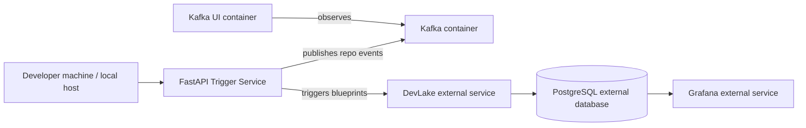

# DevLake Trigger Service — Project Documentation

## 1. Overview

This repository implements a lightweight trigger service that sits between GitHub webhook events and Apache DevLake. Its purpose is to listen for repository-related GitHub events, validate them, publish the repository identifier to Kafka, deduplicate repeated events, resolve the repository to one or more DevLake blueprint IDs, and trigger the corresponding DevLake pipeline(s).

This is not a full data collection engine. It is an orchestration layer that reduces unnecessary DevLake pipeline executions by reacting to real repository activity instead of polling repositories continuously.

### Core idea

- GitHub tells us a repository changed.
- FastAPI receives the webhook.
- The message is validated using the GitHub signature.
- The repository name is normalized to `owner/repo`.
- The message is published to Kafka.
- A consumer reads the event and checks deduplication.
- The repository is mapped to DevLake blueprint IDs.
- The blueprint is triggered through the DevLake REST API.

This makes the system event-driven and reduces wasted DevLake work.

---

## 2. Project status

This project is a working prototype / proof of concept with live runtime wiring and unit tests.

### Implemented

- FastAPI webhook endpoint
- GitHub signature validation using HMAC-SHA256
- Kafka producer and consumer
- repository-level event processing
- in-memory deduplication
- blueprint locking
- blueprint cache synchronization with DevLake
- repository → blueprint resolution
- DevLake REST API client for blueprint listing and triggering
- health and readiness endpoints
- structured logging
- retry logic for command execution
- unit tests for validation and core logic

### Partially implemented / prototype-level

- near-real-time trigger semantics (there is a 10-second consumer delay)
- in-memory deduplication only; no persistent store
- blueprint locking is process-local only; not distributed
- mapping is static and cache-backed, not dynamic from a database
- no full production-grade queue/replay/DLQ architecture

### Not implemented in this repo

- production-grade distributed Kafka/consumer deployment
- persistent deduplication state
- distributed locking across multiple app instances
- repository persistence or database for trigger service itself
- direct GitHub API client in the trigger service
- a full DevLake deployment spec inside this repository

---

## 3. Architecture summary

The actual runtime architecture implemented in the code is:

```mermaid
flowchart LR
    GH[GitHub Repository Event]
    API[FastAPI /webhook]
    SIG[GitHub Signature Verification
    X-Hub-Signature-256]
    KP[Kafka Producer]
    TOPIC[(devlake-repository-events)]
    KC[Kafka Consumer]
    DED[Deduplicator
    window = 30s]
    LOCK[Blueprint Lock Manager
    skip / queue]
    RES[Blueprint Resolver
    repo -> blueprint IDs]
    DEV[DevLake Client
    GET /blueprints
    POST /blueprints/{id}/trigger]
    DL[Apache DevLake
    pipeline execution]
    DB[(MySQL / DevLake Backend)]

    GH --> API --> SIG --> KP --> TOPIC --> KC --> DED --> LOCK --> RES --> DEV --> DL --> DB

    SYNC[Startup sync
    GET /blueprints] -. populates cache .-> RES
```

This is the most accurate abstraction of the system as it exists today.

---

## 4. Technical runtime stack

### Core application stack

- Python 3.12
- FastAPI
- Pydantic + Pydantic Settings
- Kafka via `aiokafka`
- httpx for DevLake HTTP calls
- asyncio-based background workers

### Infrastructure stack

The repository is designed to work with the following services, some of which are external to the codebase:

- Apache Kafka
- Kafka UI
- Apache DevLake
- MySQL backend used by DevLake
- GitHub webhook source

### Verified DevLake version

The runtime environment includes Apache DevLake v1.0.2.

This was confirmed from the running Docker containers:

```bash
docker ps --format 'table {{.Names}}	{{.Image}}	{{.Ports}}	{{.Status}}'
```

Observed image:

```text
devlake   devlake.docker.scarf.sh/apache/devlake:v1.0.2
```

This is a key fact for presentations and handover material.

### Database situation

The trigger service itself does not define or use a project-owned database.

The project stores state in memory only:

- blueprint cache is in memory
- deduplication is in memory
- locks are asyncio locks in process memory

The actual persistence layer for DevLake is MySQL, which is part of the DevLake infrastructure stack rather than the Python trigger service itself.

Observed runtime containers include:

- `devlake-mysql` running `mysql:8`
- `devlake` running `apache/devlake:v1.0.2`

So the architecture is:

- trigger service: in-memory orchestration
- DevLake: manages pipeline execution and stores collection data in MySQL

---

## 5. Project structure

Key files and responsibilities:

```text
app/
  __init__.py
  config.py                    # environment-driven settings
  logging_config.py            # application logging
  main.py                      # FastAPI app + startup lifecycle
  api/
    health.py                  # /health and /readiness
    webhook.py                 # POST /webhook endpoint
    dependencies/
      github_signature.py      # signature validation dependency
  core/
    exceptions.py              # custom exception types
    security.py                # HMAC SHA-256 verifier
  domain/
    blueprint_cache.py         # cache interface
    execution_command.py        # retry execution base class
  infrastructure/
    devlake_client.py          # DevLake REST client
    kafka_producer.py          # Kafka producer
    kafka_consumer.py          # Kafka consumer
    in_memory_event_deduplicator.py
    blueprint_lock_manager.py  # lock behavior for concurrent blueprints
    in_memory_blueprint_cache.py
    static_blueprint_resolver.py
  models/
    collection_job.py
    execution_plan.py
  schemas/
    github.py                  # GitHub payload models
  services/
    webhook_service.py         # normalize GitHub payload and emit Kafka event
    kafka_consumer_worker.py  # consumer processing loop
    devlake_synchronizer.py   # sync repo->blueprint cache from DevLake
    collection_planner.py     # makes execution plan from repositories
    job_executor.py           # runs blueprint triggers for each repository
    blueprint_execution_command.py
    blueprint_resolver.py
    synchronization_worker.py # refreshes cache periodically

docker-compose.yml
requirements.txt
pytest.ini
.env.example
.env
```

---

## 6. Runtime behavior and code flow

### 6.1 App startup

In `app/main.py`, the application starts by creating the key runtime objects:

- Kafka producer
- Kafka consumer
- deduplicator
- blueprint lock manager
- blueprint cache
- DevLake client
- synchronizer
- webhook service
- consumer worker

During startup, the app does the following:

1. starts Kafka producer
2. starts Kafka consumer
3. calls `synchronizer.synchronize()` to fetch DevLake blueprints
4. builds the repository-to-blueprint cache
5. starts background tasks:
   - Kafka consumer worker
   - periodic synchronization worker

This is the actual initialization flow as implemented in the code.

### 6.2 Webhook ingestion

The endpoint is defined in `app/api/webhook.py`:

```python
@router.post("/webhook")
async def github_webhook(
    payload: GitHubPushEvent,
    request: Request,
    _: None = Depends(verify_github_signature),
):
    await request.app.state.webhook_service.process(payload)
    return {"status": "received"}
```

The request is only accepted if the signature dependency validates the `X-Hub-Signature-256` header.

### 6.3 Signature validation

The security code is in `app/core/security.py`:

```python
expected = f"sha256={hmac.new(secret, payload, hashlib.sha256).hexdigest()}"
return hmac.compare_digest(expected, signature)
```

The API dependency verifies the raw body and the header before allowing the request through.

### 6.4 Normalization and Kafka publish

`WebhookService.process()` does this:

```python
repository = f"{event.repository.owner.login}/{event.repository.name}"
await self.kafka_producer.send_repository_event(repository)
```

So the GitHub payload is normalized into a repository string like:

```text
Shrinaaaath/Data-Structures
```

The Kafka producer serializes this as JSON:

```json
{"repository":"Shrinaaaath/Data-Structures"}
```

### 6.5 Kafka consumer processing

The consumer loop in `app/services/kafka_consumer_worker.py` validates the message, checks deduplication, waits 10 seconds, and then executes the job.

Pseudo-flow:

1. consume message from Kafka topic
2. require dict payload
3. require valid repository string with `/`
4. check deduplicator
5. if duplicate: skip
6. sleep 10 seconds
7. create `CollectionJob(repositories=[repository])`
8. call `job_executor.execute(job)`

### 6.6 Deduplication behavior

Implemented in `app/infrastructure/in_memory_event_deduplicator.py`.

- keyed by repository string
- time-window based
- default window = 30 seconds
- enabled by default
- in-memory only

Logic:

- if same repository seen within the active window, skip
- else allow processing and record timestamp

Sample log output from runtime evidence:

```text
Duplicate event skipped for repository: Shrinaaaath/Data-Structures (last processed 10.1s ago, window=30s)
```

### 6.7 Blueprint locking

Implemented in `app/infrastructure/blueprint_lock_manager.py`.

Supported behaviors:

- `skip`: if a blueprint is already locked, skip the trigger
- `queue`: wait in sequence rather than skipping

This is process-local and in-memory. It enforces concurrency safety among app tasks but is not a production distributed lock.

### 6.8 Repository-to-blueprint resolution

The trigger service resolves repository names to DevLake blueprint IDs through:

- blueprint cache (`InMemoryBlueprintCache`)
- synchronizer (`DevLakeSynchronizer`)
- resolver (`StaticBlueprintResolver`)

The synchronizer calls DevLake `GET /blueprints` and extracts repositories from blueprint configuration.

Example log from runtime:

```text
Blueprint 2 contains repository: Shrinaaaath/Data-Structures
Lookup 'Shrinaaaath/Data-Structures' -> {2}
Planner resolved blueprints: [2]
```

This confirms that a repo can be mapped to an actual blueprint.

### 6.9 DevLake trigger

The actual DevLake REST trigger is implemented in `app/infrastructure/devlake_client.py` as:

```python
POST /blueprints/{blueprint_id}/trigger
```

with payload:

```json
{"fullSync": false, "skipCollectors": false}
```

Then the blueprint trigger runs the pipeline.

---

## 7. Configuration and environment

Environment variables are loaded from `.env` and validated in `app/config.py`.

### Required values

From `.env.example`:

```env
GITHUB_WEBHOOK_SECRET=your-secret-here
DEVLAKE_URL=http://localhost:8080
KAFKA_BOOTSTRAP_SERVERS=localhost:9092
KAFKA_TOPIC=devlake-repository-events
KAFKA_CONSUMER_GROUP=devlake-trigger-group
DEDUP_WINDOW_SECONDS=30
ENABLE_DEDUPLICATION=True
ENABLE_BLUEPRINT_LOCKING=True
BLUEPRINT_LOCK_BEHAVIOR=skip
```

The actual runtime `.env` used includes:

```env
GITHUB_WEBHOOK_SECRET=my-secret
DEVLAKE_URL=http://localhost:8084
DEVLAKE_USERNAME=admin
DEVLAKE_PASSWORD=admin123
KAFKA_BOOTSTRAP_SERVERS=localhost:9092
KAFKA_TOPIC=devlake-repository-events
KAFKA_CONSUMER_GROUP=devlake-trigger-group
DEDUP_WINDOW_SECONDS=30
ENABLE_DEDUPLICATION=True
ENABLE_BLUEPRINT_LOCKING=True
BLUEPRINT_LOCK_BEHAVIOR=skip
```

### Validation rules in code

`Settings` enforces:

- webhook secret cannot be empty
- DevLake URL must start with `http://` or `https://`
- Kafka bootstrap servers, topic, and consumer group cannot be empty
- blueprint lock behavior must be either `skip` or `queue`

---

## 8. Docker and infrastructure setup

The repo contains `docker-compose.yml` with local infrastructure services:

### Kafka

```yaml
kafka:
  image: apache/kafka:latest
  ports:
    - "9092:9092"
```

### Kafka UI

```yaml
kafka-ui:
  image: provectuslabs/kafka-ui:latest
  ports:
    - "8088:8080"
```

The Docker services are external to the Python application, and in the live environment they were verified as running:

```text
kafka      running
kafka-ui   running
```

DevLake and MySQL are also routed via Docker but are not defined in this repo’s compose file; they are an external runtime dependency for the implementation.

---

## 9. APIs and interfaces

### FastAPI endpoints

#### GET /health

Returns:

```json
{"status": "ok"}
```

#### GET /readiness

Returns component status:

```json
{
  "status": "ready",
  "components": {
    "kafka_producer": "connected",
    "kafka_consumer": "connected",
    "blueprint_cache": "initialized"
  }
}
```

#### POST /webhook

Accepts a valid GitHub webhook payload and returns:

```json
{"status":"received"}
```

### DevLake endpoints used

- `GET /blueprints`
- `POST /blueprints/{id}/trigger`
- `GET /pipelines`

These are called by the application using `httpx` and Basic Auth credentials when configured.

---

## 10. Data model and event schema

The GitHub payload model is in `app/schemas/github.py`:

```python
class GitHubPushEvent(BaseModel):
    repository: Repository
```

Normalized repository format:

```text
owner/repository
```

This is the event identity used by:

- deduplicator
- blueprint cache lookup
- job execution

The Kafka payload is a JSON dictionary:

```json
{"repository":"owner/repository"}
```

---

## 11. Important runtime evidence from the live system

The following logs were observed during real validation of the system:

### Startup and DevLake sync

```text
INFO [app.main] Initial DevLake blueprint synchronization complete
INFO [app.services.devlake_synchronizer] Blueprint 2 contains repository: Shrinaaaath/Data-Structures
INFO [app.infrastructure.devlake_client] Fetching DevLake blueprints from http://localhost:8084/blueprints
```

### Webhook accepted

```text
INFO [app.services.webhook_service] Received webhook for repository: Shrinaaaath/Data-Structures
INFO [app.infrastructure.kafka_producer] Published repository event to Kafka topic=devlake-repository-events ...
INFO 127.0.0.1:42480 - "POST /webhook HTTP/1.1" 200 OK
```

### Kafka consumption and dedup

```text
INFO [app.infrastructure.kafka_consumer] Consumed message from topic=devlake-repository-events partition=0 offset=74
INFO [app.services.kafka_consumer_worker] Consumed repository event: Shrinaaaath/Data-Structures
INFO [app.infrastructure.in_memory_event_deduplicator] Event accepted for repository: Shrinaaaath/Data-Structures
```

### Blueprint lookup and trigger

```text
INFO [app.infrastructure.static_blueprint_resolver] Lookup 'Shrinaaaath/Data-Structures' -> {2}
INFO [app.services.job_executor] Resolved blueprint IDs for repository Shrinaaaath/Data-Structures: [2]
INFO [app.services.blueprint_execution_command] Triggering blueprint 2 for repository Shrinaaaath/Data-Structures
INFO [app.infrastructure.devlake_client] Triggering DevLake blueprint 2 at http://localhost:8084/blueprints/2/trigger
INFO [httpx] HTTP Request: POST http://localhost:8084/blueprints/2/trigger "HTTP/1.1 200 OK"
```

### Duplicate event skip

```text
INFO [app.infrastructure.in_memory_event_deduplicator] Duplicate event skipped for repository: Shrinaaaath/Data-Structures (last processed 10.1s ago, window=30s)
```

These are the strongest evidence points for the project’s behavior and are suitable for slides and demos.

---

## 12. Testing and verification

### Unit tests present

These test files exist under `tests/`:

- `tests/test_config.py`
- `tests/test_deduplication.py`
- `tests/test_devlake_client.py`
- `tests/test_kafka_flow.py`
- `tests/test_blueprint_cache_recovery.py`
- `tests/test_exceptions.py`
- `tests/test_signature.py`

### Commands to run tests

Use:

```bash
cd /home/shrinathvenkatesh/devlake-trigger
source .venv/bin/activate
PYTHONPATH=. pytest -q
```

### Verified result

This command was successfully run and produced:

```text
29 passed, 1 warning in 51.93s
```

This is the highest-confidence project-level validation result currently available in the codebase.

### Coverage of tests by concern

- configuration validation
- deduplication logic
- lock behavior
- DevLake client exception handling
- Kafka processing flow
- blueprint cache recovery
- execution retry semantics
- HMAC signature validation

### Missing automated integration tests

The project does not yet include a dedicated automated end-to-end integration suite for:

- live FastAPI → Kafka flow
- Kafka → DevLake trigger via real broker
- full GitHub webhook → Kafka → consumer → DevLake pipeline execution

These were validated manually at runtime but not captured as automated test scripts.

---

## 13. Known design limitations and handover notes

### 1. In-memory only state

The trigger service keeps:

- deduplication state in memory
- blueprint cache in memory
- locks in process memory

This means a restart resets the deduplication state and cache. For production use, this should be replaced by durable persistence and a distributed coordination solution.

### 2. Static blueprint mapping model

The repository uses a static cache that is populated from DevLake blueprints when the service starts or refreshes. It is not a dynamic, DB-backed mapping table and is not designed for many-to-many complex ownership logic.

### 3. Local single-node Kafka

The compose file defines a local single-node Kafka broker. It is suitable for development and demo purposes, but not for production HA and scaling.

### 4. Security model is intentionally thin

The webhook endpoint verifies the signature using HMAC-SHA256, which is a good baseline. However, it does not include full production security controls such as:

- authenticated access control around the webhook path
- IP allowlists
- replay protection beyond in-memory deduplication
- robust secret rotation strategy
- role-based access to DevLake configuration

### 5. DevLake remains the real collection engine

The trigger service does not replace DevLake. It only decides which pipeline to trigger. DevLake continues to perform the real GitHub collection and data extraction steps.

---

## 14. How the system works in one sequence

### Standard successful flow

1. GitHub sends a repository event.
2. FastAPI receives the webhook at `/webhook`.
3. `X-Hub-Signature-256` header is validated.
4. Event payload is normalized to `owner/repo`.
5. Kafka producer sends the repository string to `devlake-repository-events`.
6. Consumer receives and validates the message.
7. Deduplicator checks if the repository was processed recently.
8. If valid, the consumer waits 10 seconds.
9. Job executor builds a collection job.
10. Resolver looks up the repository in the blueprint cache.
11. DevLake client calls `/blueprints/{id}/trigger`.
12. DevLake executes the pipeline.
13. Data is stored in the DevLake backend, which uses MySQL.

### Example from the live system

The application was validated with repository:

```text
Shrinaaaath/Data-Structures
```

and successfully resolved:

```text
Lookup 'Shrinaaaath/Data-Structures' -> {2}
```

then triggered:

```text
POST http://localhost:8084/blueprints/2/trigger
```

with a successful HTTP 200 response and a pipeline created in DevLake.

---

## 15. Operational notes for handover

### Required local services

To run this application properly, the following services must be available:

- Kafka broker on `localhost:9092`
- Kafka UI on `localhost:8088`
- DevLake on `localhost:8084`
- DevLake MySQL backend

### Startup commands

```bash
cd /home/shrinathvenkatesh/devlake-trigger
docker compose up -d
source .venv/bin/activate
PYTHONPATH=. uvicorn app.main:app --host 0.0.0.0 --port 8000
```

### Sample webhook request

```bash
python - <<'PY'
import hashlib, hmac, json
import httpx

secret = 'my-secret'
payload = {
    "repository": {
        "name": "Data-Structures",
        "owner": {"login": "Shrinaaaath"}
    }
}
body = json.dumps(payload)
sig = 'sha256=' + hmac.new(secret.encode(), body.encode(), hashlib.sha256).hexdigest()

resp = httpx.post(
    'http://localhost:8000/webhook',
    content=body,
    headers={
        'X-Hub-Signature-256': sig,
        'Content-Type': 'application/json'
    },
    timeout=20,
)
print(resp.status_code)
print(resp.text)
PY
```

Expected result:

```text
200
{"status":"received"}
```

### Sample DevLake calls

```bash
curl -u admin:admin123 http://localhost:8084/blueprints | jq '.'
curl -u admin:admin123 http://localhost:8084/pipelines | jq '.'
```

---

## 16. Final handover summary

This project is a Python-based event-driven trigger service that bridges GitHub repository events to Apache DevLake. It validates webhook signatures, queues events in Kafka, deduplicates repeated repository activity, resolves the repository to the correct DevLake blueprint, and triggers pipeline execution through the DevLake REST API.

The system is a solid prototype and demonstration of the architecture, and it is operational in a local development environment with Kafka and DevLake. However, it does not yet provide persistent storage, production-grade distributed coordination, or a full production deployment model.

The most important implementation facts for senior review are:

- DevLake version in runtime: `v1.0.2`
- The trigger service is event-driven and asynchronous
- Kafka is used between webhook ingestion and processing
- deduplication is in-memory and repository-based
- blueprint locks are in-memory and local to the process
- DevLake remains the actual collection engine
- MySQL is the backend used by the DevLake infrastructure, not by this Python service directly
- the project is functionally validated with a green pytest suite: `29 passed`

This is the right foundation for a senior engineer to extend into a production-ready event-driven synchronization platform.

- repository string like `owner/repo`

Outputs:

- JSON payload written to the configured Kafka topic

Dependencies:

- `aiokafka.AIOKafkaProducer`
- `app.core.exceptions.KafkaPublishError`

Important classes/functions:

- `KafkaProducer.start()`
- `KafkaProducer.send_repository_event()`
- `KafkaProducer.stop()`

Current status:

IMPLEMENTED.

### G. Kafka Broker

Purpose:

Stores and distributes queued repository events.

Why it exists:

Provides buffering and message decoupling.

Inputs:

- producer writes messages to the topic

Outputs:

- consumer reads messages from the broker

Dependencies:

- Docker Compose Kafka container

Important configuration:

- `docker-compose.yml` defines a single Kafka node using KRaft
- `KAFKA_LISTENERS`, `KAFKA_ADVERTISED_LISTENERS`, `KAFKA_TOPIC`, `KAFKA_CONSUMER_GROUP`

Current status:

IMPLEMENTED as a local single-node Kafka service in Docker Compose.

### H. Kafka Topic

Purpose:

The durable transport channel for repository events.

Current topic name:

`devlake-repository-events` (default from `app/config.py` and `.env` files)

Producer behavior:

The producer sends a JSON object of the form:

```json
{ "repository": "owner/repo" }
```

Consumer behavior:

The consumer deserializes the payload and expects a dict with a `repository` field.

Current status:

IMPLEMENTED.

### I. Kafka Consumer

Purpose:

Reads repository events from Kafka and yields them to the async worker.

Why it exists:

It performs the downstream processing step after the producer writes each event.

Inputs:

- topic messages

Outputs:

- dict payloads containing repository strings

Dependencies:

- `aiokafka.AIOKafkaConsumer`

Important classes/functions:

- `KafkaConsumer.start()`
- `KafkaConsumer.consume()`
- `KafkaConsumer.stop()`

Current status:

IMPLEMENTED.

### J. Consumer Worker

Purpose:

Consumes Kafka repository events and triggers collection jobs.

Why it exists:

This is where business logic turns a repository event into DevLake execution.

Inputs:

- repository event payload from Kafka

Outputs:

- `CollectionJob(repositories=[repository])`
- execution of the job through `JobExecutor`

Dependencies:

- `JobExecutor`
- `InMemoryEventDeduplicator`

Important class/function:

- `KafkaConsumerWorker.run()` in `app/services/kafka_consumer_worker.py`

Current status:

IMPLEMENTED.

### K. Dirty Repository Manager

Not represented as a dedicated class named `DirtyRepoManager` in the repository. The closest equivalent is the repository-scoped in-memory deduplicator and the blueprint lock manager:

- `InMemoryEventDeduplicator` tracks recently processed repository keys
- `BlueprintLockManager` prevents concurrent blueprint execution for the same blueprint

There is no distinct class explicitly named `DirtyRepositoryManager` or `DirtyRepoManager` in the codebase. Any notion of “dirty repository” is currently represented as in-memory deduplication state keyed by repository name.

### L. DevLake Client

Purpose:

This is the HTTP client used by the trigger service to interact with the DevLake API.

Why it exists:

The trigger service does not directly perform GitHub collection. Instead, it asks DevLake to trigger the relevant blueprint(s).

Inputs:

- blueprint ID
- repository mapping from `StaticBlueprintResolver`

Outputs:

- HTTP POST response to DevLake /blueprints/{id}/trigger

Dependencies:

- `httpx.AsyncClient`
- `app.core.exceptions.DevLakeClientError`
- `app.core.exceptions.DevLakeServerError`

Important classes/functions:

- `DevLakeClient.get_blueprints()`
- `DevLakeClient.trigger_blueprint()`

Current status:

IMPLEMENTED.

### M. Blueprint Synchronizer / Blueprint Cache

Purpose:

The system maintains a local in-memory mapping from repository names to DevLake blueprint IDs.

Why it exists:

The service needs to resolve repository -> blueprint before triggering DevLake.

Inputs:

- DevLake GET /blueprints response

Outputs:

- `mapping: dict[str, set[int]]`

Dependencies:

- `BlueprintCache`
- `InMemoryBlueprintCache`
- `DevLakeSynchronizer`

Important classes/functions:

- `DevLakeSynchronizer.synchronize()`
- `InMemoryBlueprintCache.replace()`
- `StaticBlueprintResolver.resolve()`
- `StaticBlueprintResolver._attempt_recovery_sync()`

Current status:

IMPLEMENTED, but in-memory only and not persistent.

### N. Job Executor / Scheduler if present

Purpose:

Coordinates repository jobs and calls the blueprint execution plan.

Important classes/functions:

- `CollectionJob` in `app/models/collection_job.py`
- `ExecutionPlan` in `app/models/execution_plan.py`
- `CollectionPlanner.create_plan()` in `app/services/collection_planner.py`
- `JobExecutor.execute()` in `app/services/job_executor.py`
- `SynchronizationWorker.run()` in `app/services/synchronization_worker.py`

The repository does contain a periodic synchronization worker, but no general scheduler framework beyond this background loop.

Current status:

PARTIALLY IMPLEMENTED.

### O. PostgreSQL

Purpose:

The project’s architecture assumes PostgreSQL is the data store used by DevLake and the analytics stack.

Why it exists:

DevLake typically stores its standardized engineering data here.

Current status:

Not directly implemented in this repository. The trigger service does not connect to PostgreSQL or write to it. The code does not contain a PostgreSQL client or DB config. PostgreSQL is therefore part of the DevLake ecosystem, but not a direct component of this trigger service implementation.

### P. Grafana

Purpose:

Visualization UI for data from the DevLake/PostgreSQL layer.

Why it exists:

To visualize engineering metrics derived from the standardized data store.

Current status:

Not implemented in this repository as a configured component. There are no Grafana files, dashboards, provisioning rules, or docker-compose config for Grafana in this repo.

### Q. Kafka UI

Purpose:

A browser-based Kafka management UI.

Why it exists:

Operational convenience for inspecting Kafka topics, partitions, and messages.

Current status:

IMPLEMENTED in Docker Compose as a single service `kafka-ui`.

## 6. End-to-End Event Flow

The following is the real flow as implemented in the code.

### Example path: a repository event

1. A GitHub repository event is generated externally.
2. The event reaches the FastAPI server at `/webhook`.
3. The FastAPI app calls the `verify_github_signature` dependency.
4. The request body is read and compared to the `X-Hub-Signature-256` header using HMAC-SHA256.
5. If the signature matches, execution continues.
6. The request body is parsed into a `GitHubPushEvent` Pydantic model. The actual schema only includes `repository: Repository` and `Repository.owner.login` / `Repository.name`.
7. `WebhookService.process()` extracts `owner/repo` and logs it.
8. The service invokes `KafkaProducer.send_repository_event(repository)`.
9. Kafka producer serializes `{"repository": "owner/repo"}` and writes it to `devlake-repository-events`.
10. Kafka consumer reads the message.
11. `KafkaConsumerWorker.run()` validates the payload and checks `InMemoryEventDeduplicator.should_process(repository)`.
12. If the repository was seen within the deduplication window, the event is skipped.
13. If accepted, the worker sleeps for 10 seconds before continuing.
14. A `CollectionJob(repositories=[repository])` is created.
15. `JobExecutor.execute(job)` resolves a plan using `CollectionPlanner` + `BlueprintResolver`.
16. `StaticBlueprintResolver` looks up blueprint IDs using the in-memory cache.
17. If the cache is uninitialized, it attempts a one-time sync from DevLake before failing empty.
18. For each blueprint ID, `BlueprintExecutionCommand` calls `DevLakeClient.trigger_blueprint(blueprint_id)`.
19. The DevLake client POSTs to `/blueprints/{id}/trigger` with `{"fullSync": false, "skipCollectors": false}`.
20. If DevLake accepts the request, the pipeline is triggered.
21. DevLake performs the actual data collection against GitHub and stores results in whatever storage it uses.
22. The trigger service itself does not write to PostgreSQL or Grafana directly.

### What actually happens at each step

- The system is not a full event bus across all GitHub events; it only extracts repository info and publishes repository strings.
- It does not parse webhook event types or action payloads beyond a minimal repository object.
- The deduplication scope is repository-level and in-memory.
- The background synchronization worker refreshes the blueprint cache every 300 seconds.
- The consumer loop runs as a background task created in `app.main` during FastAPI startup.

## 7. GitHub Webhook Implementation

### Endpoint

Route: `POST /webhook`

Declaration:

`app/api/webhook.py`

Function:

`github_webhook(payload: GitHubPushEvent, request: Request, _: None = Depends(verify_github_signature))`

### HTTP method

POST

### Request structure

The webhook is typed with a Pydantic model in `app/schemas/github.py`:

```python
class GitHubPushEvent(BaseModel):
    repository: Repository
```

The model includes:

- `repository.name`
- `repository.owner.login`

This is a minimal representation. There is no validation of `zen`, `sender`, event type, action, commits, or payload version fields.

### GitHub event types supported

Not explicitly enumerated. The code accepts any request that produces a payload shape matching the minimal model. In practice, the system is only designed for repository-bearing payloads, not a full event router.

### How repository information is extracted

`WebhookService.process()` does:

```python
repository = f"{event.repository.owner.login}/{event.repository.name}"
```

No event type filtering is implemented. No payload version branching is implemented.

### How webhook signatures are verified

The FastAPI dependency `verify_github_signature()` reads the header `X-Hub-Signature-256` and compares it to the HMAC-SHA256 of the raw request body using the configured secret.

Algorithm:

```python
hmac.new(secret, payload, hashlib.sha256).hexdigest()
expected = f"sha256={digest}"
return hmac.compare_digest(expected, signature)
```

This is implemented in `app/core/security.py`.

### HMAC-SHA256 implementation

Verified in code:

- `hashlib.sha256`
- `hmac.new(..., payload, hashlib.sha256)`
- `hmac.compare_digest()`

### X-Hub-Signature-256

Required by the dependency. If missing, the request fails with HTTP 401 and detail:

```text
Missing GitHub signature
```

If mismatch occurs:

```text
Invalid GitHub signature
```

### Webhook secret configuration

Environment variables used:

- `GITHUB_WEBHOOK_SECRET` in `.env`
- `github_webhook_secret` in `Settings`

The value is validated to not be empty.

### What happens when verification fails

The dependency raises `HTTPException(status_code=401, detail=...)`.

### What response GitHub receives

The route returns a JSON object:

```json
{"status": "received"}
```

This happens only after the signature dependency passes and the service function runs.

### How webhook events enter the rest of the system

The route calls:

```python
await request.app.state.webhook_service.process(payload)
```

Then `WebhookService.process()` sends the repository string to Kafka via the producer.

## 8. Security

### Implemented security mechanisms

#### GitHub webhook signature validation

Implemented and central to the security model.

- secret stored in `.env` / environment
- raw body hashed with HMAC-SHA256
- header `X-Hub-Signature-256` compared using `compare_digest`
- explicit HTTP 401 on missing or invalid signature

Why it exists:

To ensure that requests reaching the app are genuinely from GitHub and not spoofed.

#### Secret management

The app uses `pydantic-settings.BaseSettings` to load `.env` values into `Settings`.

Important values:

- `GITHUB_WEBHOOK_SECRET`
- `DEVLAKE_URL`
- `DEVLAKE_USERNAME`
- `DEVLAKE_PASSWORD`
- Kafka connection details

No secret rotation or secret-store abstraction is implemented. This is a local environment pattern, not a hardened production secret manager.

#### DevLake authentication

The DevLake client sets `httpx.AsyncClient(auth=self._auth)` where `_auth` is a username/password tuple if credentials are supplied. The code does not use a token-based auth abstraction.

This is implemented in `app/infrastructure/devlake_client.py`.

#### Kafka security

Not implemented in the repo. The Docker Compose Kafka config uses plaintext listener configuration (`PLAINTEXT`) with no TLS or authentication. This is fine for local development, but not production-grade security.

### Security limitations

- no HTTPS termination hardening in the repo
- no JWT or API key auth for the webhook service
- no replays or nonce protection beyond HMAC
- `.env` file is present in the repo and includes secrets, which is not a production-safe pattern
- no TLS or SASL for Kafka
- no production secret management system
- no endpoint restrictions beyond GitHub signature validation

## 9. Kafka Architecture

### Why Kafka was introduced

Kafka is used as an asynchronous decoupling layer between GitHub event ingress and DevLake collection execution. This allows the webhook API to accept events quickly while downstream processing happens separately.

### Producer

`KafkaProducer` in `app/infrastructure/kafka_producer.py` publishes repository events.

Behavior:

- serializes dict to JSON bytes
- sends to configured topic with `send_and_wait`
- retries up to 3 times
- logs partition and offset on success

### Consumer

`KafkaConsumer` in `app/infrastructure/kafka_consumer.py` reads from the configured topic.

Settings:

- `auto_offset_reset="earliest"`
- `enable_auto_commit=True`
- `group_id=settings.kafka_consumer_group`

### Broker

Configured in `docker-compose.yml`:

- single node
- KRaft mode
- broker/container name: `kafka`

### Topic

Default topic:

`devlake-repository-events`

### Partition

Not explicitly configured in the code. The Kafka container has a default single-node setup; the application does not specify custom topic partitions. This means the effective partition behavior is the default broker behavior, and the app does not explicitly manage partitions.

### Consumer group

Default consumer group:

`devlake-trigger-group`

This is configured in `app/config.py` and `.env`.

### Offset handling

The consumer uses the default auto-commit behavior and start offset reset `earliest`.

This is a basic pattern, not a custom offset management strategy.

### Asynchronous processing

Yes, it is implemented.

- webhook request is fast and returns immediately
- Kafka decouples the worker from the API process
- `KafkaConsumerWorker.run()` consumes in the background

### Buffering and decoupling

These are implemented at the application level through the message queue. Kafka is used as a buffer between ingress and processing. The repository does not implement a persistent queue or robust backpressure policy beyond producer retries.

### Failure behavior

- Kafka producer startup failure logs an error but does not stop the entire app startup path; it is caught inside lifespan
- Kafka consumer startup failure is also logged
- producer send failures retry three times and then raise `KafkaPublishError`
- consumer exceptions are caught in the worker loop and logged

### Startup behavior

In `app.main`, the FastAPI lifespan:

1. starts Kafka producer
2. starts Kafka consumer
3. runs initial DevLake synchronization
4. creates background tasks for `kafka_consumer_worker.run()` and `synchronization_worker.run()`
5. cancels and stops them on shutdown

### Current number of partitions

Not explicitly configured in the repository. The code does not create the topic manually, and Docker Compose does not define a `partitions` count. Therefore this is not verifiable from the current codebase.

### Kafka UI

`kafka-ui` is defined in Docker Compose on port 8088 mapped to 8080. It connects to Kafka broker at `kafka:29092`.

### What Kafka does and does not do

Kafka does:

- buffer repository events
- decouple the webhook from worker processing
- deliver messages to a consumer group

Kafka does not do:

- apply business deduplication logic at the cluster level
- select DevLake blueprints
- call DevLake APIs
- resolve repository metadata
- persist application-level repository state

Important: deduplication is handled in application code, not Kafka itself.

## 10. Deduplication

### Actual deduplication implementation

The project has an in-memory event deduplicator:

`app/infrastructure/in_memory_event_deduplicator.py`

Class:

`InMemoryEventDeduplicator`

Behavior:

- keyed by repository string
- keeps a dict of `repository -> timestamp`
- default window is 30 seconds from `DEDUP_WINDOW_SECONDS`
- if `enabled` is false, no deduplication happens
- if a repository is seen again within the window, it is skipped

### What is considered a duplicate

A duplicate is a repository event for the same repository key within a time window.

Example:

- `owner/repo-a` first triggers processing
- second event for same repo within 30 seconds is skipped

### What identifier/key is used

Repository string: `"owner/repo"`

The code does not use GitHub delivery IDs or webhook IDs for deduplication.

### Whether GitHub delivery IDs are used

No. There is no GitHub delivery ID parsing or tracking in the codebase.

### Repository-level deduplication vs event deduplication

There are two related but distinct ideas implemented:

1. Event deduplication: `InMemoryEventDeduplicator` sees repeated repository events and suppresses them within a time window.
2. Repository-level dirty tracking / coalescing: there is no dedicated repository dirty set implemented as a persistent or conceptual manager. The in-memory deduplicator is the closest thing, but it is not a general dirty-repo manager and it is not persistent.

### Time window

Default: 30 seconds

Configured by:

- `DEDUP_WINDOW_SECONDS`
- `app/config.py: dedup_window_seconds: int = 30`

### Where deduplication state is stored

In memory in Python process memory:

```python
self._seen_events: dict[str, float] = {}
```

### How long it is retained

Until the time window expires. The implementation purges expired entries in `_purge_expired`.

### What happens to duplicate events

They are ignored by `should_process()` and return `False`.

### How concurrency is handled

The deduplicator uses `asyncio.Lock()`:

```python
self._lock = asyncio.Lock()
```

This makes the window checks and update operations atomic within the event loop.

### Persistent or in-memory

In-memory only. No Redis, database, or durable queue state is used for deduplication.

### Important caveat

This is not a true distributed deduplication system. A restart loses state.

## 11. Dirty Repository Management

There is no explicit `DirtyRepoManager` or `DirtyRepositoryManager` class in the current codebase.

The closest equivalent is the in-memory repository deduplicator and the blueprint lock manager.

### What a “dirty repository” means

The concept is implied, but not explicitly named in code. A repository is effectively “dirty” from the perspective of the trigger service when it has recently emitted an event and therefore should be treated as active for collection.

### Why the concept exists

The service wants to avoid redundant pipeline triggers when the same repository is still in its recent interaction window.

### How a repository becomes dirty

A repository becomes “active” when a valid repository event is accepted by the deduplicator and allowed through the Kafka consumer worker.

### How it is stored

In memory as `repository -> timestamp` in `InMemoryEventDeduplicator`.

### How it is removed/cleaned

The implementation purges stale timestamps when `should_process()` is called and the age exceeds `window_seconds`.

### How multiple events affect the same repository

Repeated events within the window are suppressed; after the window expires, a new event is accepted.

### Whether this mechanism currently coalesces events

Not as a formal queue mechanism. It only suppresses repeated events within the window. It does not create a “one pending cleanup job per repo” abstraction.

### Persistence across restarts

No. It is process-local memory.

### Thread/async safety

The code uses `asyncio.Lock()`, so it is safe within the async event loop for that process.

### Interaction with Kafka

Kafka stores messages; deduplication is applied after consumption in the worker. This means the broker may still hold duplicate messages, and the application decides whether to act.

## 12. DevLake Integration

### Exact communication model

The trigger service communicates with DevLake via REST over HTTP.

The client:

`app/infrastructure/devlake_client.py`

### Base URL

Loaded from `DEVLAKE_URL` in `Settings`.

Example:

- `.env.example` uses `http://localhost:8080`
- `.env` uses `http://localhost:8084`

### REST endpoints actually used

1. `GET /blueprints`
2. `POST /blueprints/{blueprint_id}/trigger`

### Blueprint retrieval

`DevLakeClient.get_blueprints()` calls:

```python
GET {base_url}/blueprints
```

Then returns `response.json()`.

### Blueprint synchronization

`DevLakeSynchronizer.synchronize()` reads the blueprints payload and builds a mapping from repository names to blueprint IDs by scanning for tasks whose `plugin` equals `github_graphql` and whose task options include `fullName`.

Example extracted pattern:

```python
if task["plugin"] != "github_graphql":
    continue
repository = task["options"]["fullName"]
```

This is how the app maps repo names to blueprint IDs.

### Blueprint cache

`InMemoryBlueprintCache` stores the mapping in process memory. There is no persistent store.

### Pipeline triggering

`DevLakeClient.trigger_blueprint(blueprint_id)` does:

```python
POST {base_url}/blueprints/{blueprint_id}/trigger
payload = {"fullSync": False, "skipCollectors": False}
```

It raises typed errors on 4xx or 5xx response codes.

### Request/response handling

The client uses `httpx.AsyncClient` with:

- timeout
- optional basic authentication
- `response.raise_for_status()`
- JSON parsing

### Error handling

- 4xx -> `DevLakeClientError` (PermanentError)
- 5xx -> `DevLakeServerError` (TransientError)
- network / timeout -> `DevLakeServerError`

### Authentication

Optional Basic Auth via username/password in `.env`.

### Retry behavior

The trigger itself does not retry DevLake calls at the Kafka worker level. The higher-level `ExecutionCommand.execute()` wraps command execution and retries up to 3 times for transient exceptions.

### Difference between trigger service and DevLake

Trigger service:

- listens for repository events
- resolves repo -> blueprint mapping
- calls DevLake blueprint trigger endpoints
- uses Kafka and async workers

DevLake:

- is the collection engine that actually performs GitHub data collection
- stores and processes data in its own stack
- likely uses PostgreSQL beneath it
- is not reimplemented here

## 13. Blueprint Resolution

### What a DevLake Blueprint is in this project

A blueprint is a DevLake pipeline definition. The app treats it as the collection unit associated with a repository or set of repositories. A blueprint is identified by an integer ID.

### Why blueprint resolution is necessary

The system receives only a repository string. It needs to find the correct DevLake blueprint ID(s) that correspond to that repository before it can trigger collection.

### How repositories are mapped to blueprints

The synchronization process fetches blueprints from DevLake and inspects each task in each blueprint plan:

```python
for blueprint in response["blueprints"]:
    for stage in blueprint["plan"]:
        for task in stage:
            if task["plugin"] == "github_graphql":
                repository = task["options"]["fullName"]
                mapping.setdefault(repository, set()).add(blueprint_id)
```

This creates a repository-to-blueprint map.

### How the blueprint cache works

`InMemoryBlueprintCache` stores the mapping and exposes:

- `get_blueprints(repository)`
- `replace(mapping)`
- `is_initialized`

### When synchronization occurs

- at startup inside `app.main.lifespan()`
- periodically every 300 seconds by `SynchronizationWorker`
- when cache is uninitialized and a lookup occurs, via `_attempt_recovery_sync()`

### What happens if a repository has no matching blueprint

`StaticBlueprintResolver._lookup()` yields an empty set for that repository, and the job executor will not trigger any blueprint.

### What happens if the cache is stale

The worker refreshes the cache periodically. If the cache is uninitialized, it attempts a recovery `synchronize()` before failing empty. It does not implement complex cache invalidation beyond full replacement.

### How errors are handled

- DevLake sync failure at startup is logged as warning
- sync failure during scheduled refresh is logged as error
- if cache is not initialized and sync fails, the resolver returns an empty list and no blueprint is triggered

## 14. Background Workers and Scheduling

### Kafka consumer worker

Class:

`KafkaConsumerWorker`

Role:

- loop over Kafka consumer messages
- validate repository strings
- deduplicate
- delay 10 seconds
- construct and execute collection jobs

### Synchronization worker

Class:

`SynchronizationWorker`

Role:

- refreshes the DevLake blueprint cache
- loop executes every 300 seconds

### Job executor

Class:

`JobExecutor`

Role:

- create execution plan from repository job
- then run blueprint trigger commands
- enforce blueprint locking

### Scheduler

No standalone scheduler framework is implemented beyond a simple `while True` loop inside `SynchronizationWorker` and background tasks launched on startup. There is no cron-like scheduler, no APScheduler, or persistent queue scheduler in the repo.

### Polling interval

The synchronization worker default interval is 300 seconds

```python
interval_seconds: int = 300
```

### Background tasks

Started in `app.main.lifespan()`:

```python
consumer_task = asyncio.create_task(kafka_consumer_worker.run())
sync_task = asyncio.create_task(synchronization_worker.run())
```

These are cancelled during shutdown.

### Startup/shutdown behavior

Startup:

- Kafka producer starts
- Kafka consumer starts
- initial DevLake synchronization runs
- background tasks are created

Shutdown:

- cancel background tasks
- stop Kafka consumer
- stop Kafka producer

### Concurrency

The service uses asyncio tasks and per-blueprint locks. It does not implement distributed concurrency control.

### Webhook-driven processing vs background synchronization

Webhook-driven processing:

- triggered by GitHub events
- sends repo to Kafka
- eventually triggers DevLake blueprint(s)

Background synchronization:

- refreshes the blueprint cache from DevLake
- updated periodically to keep repo -> blueprint mapping fresh

This combination is used to keep the mapping current while still enabling event-driven triggering.

## 15. Database / PostgreSQL

### How PostgreSQL fits into the architecture

The repository does not contain PostgreSQL code or configuration. It assumes PostgreSQL is part of the broader DevLake ecosystem where standardized engineering data is stored.

### Which component owns the database

DevLake owns the data store relationship in the architectural narrative. The trigger service does not own or connect to PostgreSQL directly.

### What DevLake stores

The project language implies that DevLake stores standardized engineering data, including GitHub-related repository data.

### Repository information and GitHub-related data

The trigger service extracts repository names and resolves blueprint IDs, but it does not store repository events in a database.

### How collected data becomes available to analytics

The docs and language imply the flow:

- DevLake collects GitHub data
- stores it in PostgreSQL
- Grafana reads the data source

This is part of the platform architecture, but it is not directly implemented within this repo.

### Important tables or database configuration

Not identifiable from the repository. No SQL schema or DB client code is included. This is not verified in the current codebase.

### Database connection configuration

No PostgreSQL connection string or database client config exists in this project’s Python modules.

## 16. Grafana

### Role of Grafana

Grafana is a visualization layer for engineering metrics derived from the data stored by DevLake/PostgreSQL.

### Data source

Not defined in this repository. The project does not include Grafana config, datasource provisioning, or dashboards.

### What data it visualizes

The project expects metrics of standardized engineering data, but actual dashboards are not provided here.

### Relationship to PostgreSQL/DevLake

The implied architecture is:

GitHub events -> DevLake -> PostgreSQL -> Grafana

### Whether dashboards are provisioned automatically

Not in this repository. No Grafana provisioning files or Docker setup are included.

### Current status

Not verified as implemented in the repo. The code references Grafana conceptually but not in setup files.

## 17. Configuration

The application configuration is defined in `app/config.py` and loaded from `.env` using `pydantic_settings.BaseSettings`.

### Important configuration variables

| Variable | Purpose | Example / format | Required | Where used |
|---|---|---|---|---|
| `GITHUB_WEBHOOK_SECRET` | Shared secret for GitHub webhook validation | `<WEBHOOK_SECRET>` | Yes | `app.core.security.GitHubSignatureVerifier` |
| `DEVLAKE_URL` | Base URL for DevLake HTTP API | `http://localhost:8084` | Yes | `DevLakeClient` |
| `DEVLAKE_USERNAME` | Basic auth username for DevLake | `<DEVLAKE_USERNAME>` | Optional in code but expected by app | `DevLakeClient` |
| `DEVLAKE_PASSWORD` | Basic auth password for DevLake | `<DEVLAKE_PASSWORD>` | Optional in code but expected by app | `DevLakeClient` |
| `KAFKA_BOOTSTRAP_SERVERS` | Kafka broker address | `localhost:9092` | Yes | producer / consumer |
| `KAFKA_TOPIC` | Topic name | `devlake-repository-events` | Yes | producer / consumer |
| `KAFKA_CONSUMER_GROUP` | Kafka consumer group ID | `devlake-trigger-group` | Yes | consumer |
| `DEDUP_WINDOW_SECONDS` | Event deduplication window | `30` | Optional (default 30) | `InMemoryEventDeduplicator` |
| `ENABLE_DEDUPLICATION` | Enables or disables deduplication | `True` | Optional | deduplicator |
| `ENABLE_BLUEPRINT_LOCKING` | Enables blueprint locking | `True` | Optional | `BlueprintLockManager` |
| `BLUEPRINT_LOCK_BEHAVIOR` | Lock policy for blueprint concurrency | `skip` or `queue` | Optional | `BlueprintLockManager` |

### Secret handling notes

- `.env` exists in the repo and contains real values such as `my-secret`, `admin`, `admin123`.
- This is not a production-safe pattern.
- The documentation intentionally redacts secrets when describing configuration.

## 18. Docker / Deployment

### Current deployment architecture in repo

The repository contains a Docker Compose file defining only Kafka and Kafka UI.

```yaml
services:
  kafka:
    image: apache/kafka:latest
    container_name: kafka
  kafka-ui:
    image: provectuslabs/kafka-ui:latest
    container_name: kafka-ui
```

### Components that run in Docker

- Kafka broker
- Kafka UI

### Components that run directly on the host

- FastAPI service (likely via Python/uvicorn on the local environment)
- the trigger service code itself

### Components not configured in this repo

- DevLake container
- PostgreSQL container
- Grafana container
- ngrok

These are not present in `docker-compose.yml` and are not implemented in the current codebase.

### Port mappings

From Docker Compose:

- `9092:9092` for Kafka
- `8088:8080` for Kafka UI

### Docker networks

The compose file uses default Docker networking; there is no custom network configuration in the repo.

### Volumes

No persistent data volumes are defined for Kafka or UI in the repo.

### Container dependencies

The Kafka UI service depends_on Kafka.

### Deployment diagram



### Important caveat

The deployment layout in the repo is local and partial. It is not a complete environment for DevLake/PostgreSQL/Grafana.

## 19. Local Development Setup

The repository does not include a complete README or setup script, but the following can be derived from the project files and standard Python/FastAPI usage.

### Starting Docker / Kafka

Verified from repo config:

```bash
docker compose up -d kafka kafka-ui
```

This is inferred from the Docker Compose file and is the natural start command for the services declared in the repo.

### Starting Kafka UI

```bash
docker compose up -d kafka-ui
```

### Activating Python virtual environment

From the repository layout, the project includes a `.venv` directory. The project’s test run used:

```bash
. .venv/bin/activate
```

This is verified by the test execution command.

### Starting FastAPI

The app object is `app.main:app`, so a standard FastAPI startup pattern is:

```bash
uvicorn app.main:app --host 0.0.0.0 --port 8000 --reload
```

This is standard and inferred from FastAPI conventions, but not explicitly scripted in the repository.

### Starting ngrok

Not verified in the repository. There is no ngrok config or startup script.

### Checking container status

```bash
docker ps
```

### Checking DevLake

Not directly configured in this repo. The app expects DevLake at `DEVLAKE_URL`, but there is no local run script here.

### Checking Kafka

Use Kafka UI at `http://localhost:8088` or inspect the Kafka broker and topic using Docker or Kafka tools outside the repo.

### Checking FastAPI

```bash
curl http://localhost:8000/health
```

This matches the app’s `/health` endpoint.

### Checking logs

The app logs to stdout using `logging.basicConfig` in `app/logging_config.py`.

Examples:

```bash
docker compose logs -f kafka
```

```bash
docker compose logs -f kafka-ui
```

```bash
uvicorn app.main:app --host 0.0.0.0 --port 8000 --reload
```

## 20. API Endpoints

### /health

Method: GET

Purpose: liveness check

Returns:

```json
{"status": "ok"}
```

### /readiness

Method: GET

Purpose: readiness check for Kafka producer, Kafka consumer, and blueprint cache

Behavior:

- if all components connected/initialized, status is `ready`
- otherwise `not_ready`
- if not ready, HTTP 503 is returned

### /

Method: GET

Purpose: basic root endpoint

Returns:

```json
{"message": "DevLake Trigger Service is running!"}
```

### /webhook

Method: POST

Purpose: GitHub event ingestion

Headers required:

- `X-Hub-Signature-256`

Authentication/security:

- HMAC-SHA256 signature validation against configured secret

Request body:

The API expects a minimal GitHub event model containing a repository object.

Example shape:

```json
{
  "repository": {
    "name": "example-repo",
    "owner": {
      "login": "example-org"
    }
  }
}
```

Response on success:

```json
{"status": "received"}
```

Errors:

- 401 if signature missing
- 401 if signature invalid

## 21. Error Handling

### GitHub webhook signature is invalid

Handled by `verify_github_signature()`, which raises HTTP 401.

### Kafka is unavailable

Producer/consumer startup errors are logged in `app.main.lifespan()`. The app continues to startup but the readiness endpoint reflects the status as disconnected.

### Kafka producer fails

`KafkaProducer.start()` raises `KafkaPublishError`; `send_repository_event()` retries up to 3 times and then raises `KafkaPublishError`.

### Kafka consumer fails

The worker catches broad exceptions and logs them. Invalid data is skipped.

### DevLake is unavailable

- startup sync failure logs a warning
- resolver recovery sync fails and returns empty list
- blueprint trigger call may raise `DevLakeServerError`

### DevLake returns an error

`DevLakeClient` raises `DevLakeClientError` for 4xx and `DevLakeServerError` for 5xx or network failures.

### Blueprint is missing

`StaticBlueprintResolver` returns empty list for repositories with no matching blueprint; no trigger calls are made.

### Repository cannot be resolved

No blueprint IDs are resolved, so no trigger occurs.

### Application restarts

The in-memory deduplicator resets state. The blueprint cache is initially empty and may recover if DevLake is available.

### Network connection fails

`DevLakeClient` converts connection problems into `DevLakeServerError`.

## 22. Logging and Observability

### Logging framework

The project uses Python’s standard `logging` module with a custom formatter in `app/logging_config.py`.

### Important log messages

Examples from code:

- Kafka connect attempts
- Kafka publish success/failure
- blueprint cache refresh
- blueprint trigger attempts
- duplicate event skip messages
- invalid webhook signature
- DevLake trigger errors

### Startup logs

The lifespan logs include:

- “Initializing DevLake Trigger Service startup...”
- “Initial DevLake blueprint synchronization complete” or failure warning

### Kafka connection logs

The producer and consumer log connection attempts and success or failure.

### DevLake synchronization logs

`DevLakeSynchronizer.synchronize()` logs blueprint mapping generation and repository entries.

### Webhook logs

`WebhookService.process()` logs the repository it received.

### Error logs

Exceptions are logged with stack traces in some places using `exc_info=True`.

### How to inspect logs

Because logs are sent to stdout, the app logs are visible in the terminal running uvicorn or in container logs for Kafka if running in Docker. There is no dedicated log aggregation system in this repo.

## 23. Testing

### Test framework

Pytest is the project’s test runner.

### Unit tests

Present in:

- `tests/test_deduplication.py`
- `tests/test_config.py`
- `tests/test_devlake_client.py`
- `tests/test_kafka_flow.py`
- `tests/test_blueprint_cache_recovery.py`

### Integration-style tests

`tests/test_kafka_flow.py` exercises end-to-end style service/worker flow with mocks and `TestClient`.

### What is tested

- deduplication logic
- blueprint locking behavior
- configuration validation
- DevLake client error mapping
- Kafka flow from webhook service to job executor
- cache recovery when blueprint cache is not initialized

### What is not tested

- real Kafka broker behavior against actual Kafka service
- real DevLake connectivity
- real webhook delivery from GitHub
- production configuration or TLS/security behavior
- real PostgreSQL/Grafana integration

### How to run tests

The repository currently uses pytest in the venv:

```bash
. .venv/bin/activate
pytest -q
```

### Important test status finding

The current pytest run fails during collection due to import-name collisions:

- root-level `test_config.py`
- root-level `test_signature.py`
- same-named files inside `tests/`

This is an actual repository issue and is not a hypothetical problem.

## 24. Actual Verified Test / Demonstration Flow

This is the strongest evidence-based flow the repository supports.

### Verified from code and tests

1. The app exposes a FastAPI webhook route.
2. The app verifies an HMAC-SHA256 signature.
3. A valid webhook calls `WebhookService.process()`.
4. That service publishes a repository payload to Kafka.
5. The Kafka consumer worker consumes repository messages.
6. Valid messages create a `CollectionJob` and call `JobExecutor`.
7. The executor resolves blueprint IDs via a resolver.
8. The DevLake client triggers blueprints via HTTP.

### Steps that are inferred rather than directly verified in this repo

- GitHub actually sending a webhook to the running service
- external DevLake running and returning blueprints
- real DevLake blueprint pipeline execution
- PostgreSQL data persistence
- Grafana metrics
- ngrok tunnel to an exposed local webhook endpoint

### Suggested demonstration flow

1. Start Kafka via Docker Compose.
2. Start FastAPI via uvicorn.
3. Configure GitHub webhook secret and DevLake URL in `.env`.
4. Send a valid signed webhook payload to `/webhook`.
5. Confirm Kafka receives a repo event.
6. Confirm consumer worker takes the message and resolves blueprint IDs.
7. Confirm DevLake API is triggered.
8. Observe logs and Kafka UI.

This flow is consistent with the code, but not fully end-to-end validated against a live GitHub + DevLake environment in this repo.

## 25. Architectural Decisions

### Event-driven architecture

Problem:

Polling thousands of repositories is slow and noisy.

Decision:

Use GitHub webhooks as the trigger source and Kafka as the decoupling layer.

Reason:

A webhook is a signal that a repository changed, which is more selective than polling for every repo on a timer.

Benefit:

Reduces unnecessary collection trigger volume.

Trade-off:

Still requires DevLake to do the actual collection work, and the trigger service relies on external infrastructure.

### GitHub Webhooks

Problem:

Need repository change signals without polling.

Decision:

Use GitHub webhook endpoints to receive events.

Reason:

GitHub can notify the system when actions happen without the service continuously interrogating GitHub.

Benefit:

Lower latency than polling.

Trade-off:

Requires a reachable public endpoint or tunneling mechanism for GitHub to reach the app.

### FastAPI

Problem:

Need a lightweight HTTP API server to receive webhook requests and expose health endpoints.

Decision:

Use FastAPI.

Reason:

It is Python-native, asynchronous, and simple to pair with async Kafka clients and Pydantic validation.

Benefit:

Rapid API development and typed payload parsing.

Trade-off:

No advanced API security model beyond the secret signature check in this repo.

### Kafka

Problem:

Need to decouple webhook ingestion from downstream processing and add buffering.

Decision:

Use Kafka.

Reason:

The service can accept webhooks quickly and process them asynchronously.

Benefit:

Buffering, decoupling, and message durability behavior are available.

Trade-off:

More moving parts and operational complexity than a direct in-process call path.

### Consumer groups

Problem:

Need multiple consumers to read the same topic safely when scaling or coordinating processing.

Decision:

Use a consumer group configuration value.

Reason:

This aligns with Kafka’s standard message delivery model.

Benefit:

Better scaling and partition-aware consumption.

Trade-off:

The current repo uses only a single local consumer and does not demonstrate multi-consumer scaling.

### DevLake REST APIs

Problem:

The trigger service needs to trigger collection without reimplementing DevLake’s collection engine.

Decision:

Call DevLake’s REST API.

Reason:

DevLake is the actual data collection system; the trigger service should orchestrate it, not duplicate it.

Benefit:

Reuse DevLake’s existing collection engine and standardized blueprint model.

Trade-off:

The trigger service depends on DevLake being present and correctly configured.

### PostgreSQL

Problem:

Need a durable and structured place to store analytics data.

Decision:

The architecture assumes DevLake uses PostgreSQL as its persistence layer.

Reason:

PostgreSQL is a common and mature choice for structured engineering data.

Benefit:

Analytic querying and dashboarding from a stable relational database.

Trade-off:

This is not directly configured in the trigger repo itself; it is part of the wider DevLake ecosystem.

### Grafana

Problem:

Need a dashboard and visualization layer for engineering metrics.

Decision:

Use Grafana as the visualization tool over the standardized data layer.

Reason:

Grafana is a standard fit for operational dashboards and trend analysis.

Benefit:

Visible metrics and charts for engineering data.

Trade-off:

No Grafana provisioning or dashboards are present in the codebase.

## 26. Scalability

### Thousands of repositories

The architecture is designed to handle a large repository population better than polling because it triggers events only on observed repo activity. However, the project does not implement distributed scaling beyond a single Kafka broker and a single consumer loop.

### High webhook volume

The current service is an async FastAPI app with a Kafka producer, so it can absorb bursts better than pure synchronous processing. But there is no backpressure or DLQ strategy implemented here.

### Kafka buffering

Kafka is an improvement over a direct synchronous trigger action, but the repo’s design creates a single broker/single topic model with no evidence of high-partition scaling.

### Consumer scaling

The project defines a consumer group, but the repo does not actually demonstrate multiple consumers or partition scaling. At present, the consumer loop is a single background task.

### DevLake pipeline concurrency

The blueprint lock manager enforces per-blueprint prevention of concurrent triggers. The implementation is in-memory and local; it is not a distributed lock.

### GitHub API rate limits

This project does not eliminate rate limits. DevLake still makes the real GitHub API calls when collecting data. The trigger service reduces redundant collection triggers, but cannot avoid all GitHub collection costs.

### Database scalability

Not implemented directly in this repo. PostgreSQL and DevLake are assumed to live outside the trigger service code.

### Bottlenecks and single points of failure

Current observed bottlenecks and hazards:

- in-memory deduplicator resets on restart
- in-memory blueprint cache resets on restart
- single Kafka broker in Docker Compose
- single consumer loop
- no persistent job state
- no durable deduplication store
- no DLQ / retry queue
- local environment assumptions for DevLake and GitHub connectivity

## 27. Performance / Rate Limiting

### Relationship between GitHub API, DevLake, and the trigger service

The trigger service does not call GitHub directly. Instead, it waits for GitHub events and then asks DevLake to run a blueprint. DevLake is the component that ultimately makes the GitHub API requests needed for collection.

### Why this matters

If the trigger service sends many duplicate repository events, DevLake may trigger many redundant blueprints, which results in extra GitHub API requests. The deduplicator reduces this by skipping repeated repository events in a window.

### Example request calculation

This is an illustrative example, not measured data:

- 10,000 repositories monitored
- polling every 5 minutes
- each cycle triggers a DevLake blueprint for many repos
- if a repository has not changed, those blueprint triggers are redundant

A webhook-driven approach can reduce unnecessary blueprint executions to only repositories that actually emitted activity. The exact reduction depends on the collection logic and DevLake blueprint design.

### Who makes GitHub API requests

The repository does not implement a GitHub API client; it is assumed DevLake does this when a blueprint triggers collection.

### Why a webhook does NOT mean only one GitHub API request

A webhook is just a signal. It does not mean DevLake does only one GitHub request. In fact, a blueprint may trigger a substantial collection process that itself calls GitHub multiple times to fetch repository metadata, PR information, issue information, and other data.

### Why reducing unnecessary DevLake pipeline executions can reduce redundant GitHub API calls

By avoiding unnecessary blueprint triggers, the system reduces the number of times DevLake needs to perform collection work and thus reduces avoidable GitHub API consumption.

### Important nuance

The trigger service does not claim to reduce GitHub API use to zero. It only aims to reduce unnecessary collection triggers that lead to redundant API requests.

## 28. Current Architecture vs Original Approach

| Topic | Old / default approach | Current implemented approach |
|---|---|---|
| Trigger mechanism | Periodic polling | GitHub webhook + Kafka |
| Request frequency | Continuous scan of all repos | Event-driven repo-specific signal |
| Latency | Delayed until next poll | Lower latency after webhook arrives |
| Scalability | Poor as repo count grows | Better at reducing noise, but still limited by single-node local setup |
| API usage | Many polling calls | Fewer redundant collection triggers |
| Failure handling | Polling can eventually recover | Kafka buffering and async worker adds decoupling |
| Asynchronous processing | Not inherent | Implemented via Kafka and background tasks |
| Repository targeting | Broad repository polling | Repository-level event targeting |

### Important difference

The project is not a full replacement for DevLake’s collection engine. It is an orchestration layer aimed at reducing unnecessary collection triggers.

## 29. Current Limitations

This section is essential because the current repo is a prototype and not a complete production platform.

### Verified limitations in the codebase

- in-memory deduplication, lost on restart
- in-memory blueprint cache, lost on restart
- single Kafka broker / single local deployment
- no custom partition config
- no persistent job state
- no distributed locking or HA
- no production-grade secret management
- no TLS / SASL for Kafka
- no durable retry / DLQ handling beyond a few retries
- no actual production webhook endpoint exposure strategy
- no PostgreSQL or Grafana implementation in this repo
- no ngrok component in repo
- limited GitHub payload schema (minimal repo object only)
- test suite fails during collection due to file-name conflicts

### Architectural limitations

- The trigger service is a thin orchestrator; it does not replace DevLake’s GitHub collection logic.
- It does not directly verify repo ownership beyond Webhook secret + repository string extraction.
- It relies on the DevLake blueprint mapping being correct and available.

## 30. Future Improvements

These are not implemented as verified features.

- horizontal Kafka consumers
- more partitions and topic tuning
- persistent deduplication store
- persistent job tracking and replay
- dead-letter queue and alerting
- rate-limit-aware scheduling
- repository-level coalescing and delay buffering
- distributed lock manager
- production webhook endpoint with secure networking
- proper auth and authorization layer
- database-backed cache
- Grafana provisioning and dashboards
- full DevLake/PostgreSQL/Grafana deployment stack
- monitoring and metrics integration

## 31. Project File Structure

```text
/devlake-trigger
├── .env
├── .env.example
├── README.md
├── docker-compose.yml
├── doc.json
├── generate_signature.py
├── requirements.txt
├── test_config.py
├── test_get_blueprints.py
├── test_signature.py
├── PROJECT_DOCUMENTATION.md
├── app/
│   ├── __init__.py
│   ├── config.py
│   ├── logging_config.py
│   ├── main.py
│   ├── api/
│   │   ├── __init__.py
│   │   ├── health.py
│   │   ├── webhook.py
│   │   └── dependencies/
│   │       └── github_signature.py
│   ├── clients/
│   │   └── devlake_client.py
│   ├── core/
│   │   ├── exceptions.py
│   │   └── security.py
│   ├── domain/
│   │   ├── blueprint_cache.py
│   │   └── execution_command.py
│   ├── infrastructure/
│   │   ├── blueprint_lock_manager.py
│   │   ├── devlake_client.py
│   │   ├── in_memory_blueprint_cache.py
│   │   ├── in_memory_event_deduplicator.py
│   │   ├── kafka_consumer.py
│   │   ├── kafka_producer.py
│   │   └── static_blueprint_resolver.py
│   ├── models/
│   │   ├── collection_job.py
│   │   └── execution_plan.py
│   ├── schemas/
│   │   └── github.py
│   └── services/
│       ├── blueprint_execution_command.py
│       ├── blueprint_resolver.py
│       ├── collection_planner.py
│       ├── devlake_synchronizer.py
│       ├── execution_engine.py
│       ├── job_executor.py
│       ├── kafka_consumer_worker.py
│       ├── synchronization_worker.py
│       └── webhook_service.py
├── tests/
│   ├── test_blueprint_cache_recovery.py
│   ├── test_config.py
│   ├── test_deduplication.py
│   ├── test_devlake_client.py
│   ├── test_exceptions.py
│   ├── test_kafka_flow.py
│   └── test_signature.py
└── .venv/
```

### Responsibility summary

- `app/main.py`: startup, app lifecycle, instantiation, background tasks
- `app/api/webhook.py`: webhook route
- `app/api/health.py`: health and readiness checks
- `app/core/security.py`: signature verification
- `app/infrastructure/kafka_producer.py`: Kafka write path
- `app/infrastructure/kafka_consumer.py`: Kafka read path
- `app/infrastructure/devlake_client.py`: REST calls to DevLake
- `app/services/devlake_synchronizer.py`: builds repo -> blueprint mapping
- `app/services/job_executor.py`: executes blueprint triggers
- `app/services/kafka_consumer_worker.py`: transforms Kafka messages into collection jobs
- `app/infrastructure/in_memory_event_deduplicator.py`: suppresses duplicate repo events
- `app/infrastructure/static_blueprint_resolver.py`: resolves repo to blueprint IDs using in-memory cache
- `app/config.py`: environment configuration and validation
- `docker-compose.yml`: local Kafka + Kafka UI infrastructure

## 32. Important Classes and Functions

| Component | File | Class / Function | Responsibility |
|---|---|---|---|
| FastAPI app | `app/main.py` | `lifespan` | startup/shutdown orchestration |
| FastAPI app | `app/main.py` | `app` | main FastAPI instance |
| Webhook route | `app/api/webhook.py` | `github_webhook` | receives GitHub webhook requests |
| Signature validation | `app/api/dependencies/github_signature.py` | `verify_github_signature` | checks `X-Hub-Signature-256` |
| Signature verifier | `app/core/security.py` | `GitHubSignatureVerifier.verify` | HMAC-SHA256 verification |
| Settings loader | `app/config.py` | `Settings` | environment config validation |
| Webhook service | `app/services/webhook_service.py` | `WebhookService.process` | extract repo and publish to Kafka |
| Kafka producer | `app/infrastructure/kafka_producer.py` | `KafkaProducer.send_repository_event` | write message to topic |
| Kafka consumer | `app/infrastructure/kafka_consumer.py` | `KafkaConsumer.consume` | read topic messages |
| Deduplicator | `app/infrastructure/in_memory_event_deduplicator.py` | `InMemoryEventDeduplicator.should_process` | skip duplicate repo events |
| Blueprint cache | `app/infrastructure/in_memory_blueprint_cache.py` | `InMemoryBlueprintCache.replace` | store repo -> blueprint mapping |
| Blueprint resolver | `app/infrastructure/static_blueprint_resolver.py` | `StaticBlueprintResolver.resolve` | repo lookup with recovery sync |
| DevLake synchronizer | `app/services/devlake_synchronizer.py` | `DevLakeSynchronizer.synchronize` | fetch blueprints and rebuild mapping |
| Job executor | `app/services/job_executor.py` | `JobExecutor.execute` | run collection jobs |
| Collection planner | `app/services/collection_planner.py` | `CollectionPlanner.create_plan` | create plan from repo list |
| Blueprint execution command | `app/services/blueprint_execution_command.py` | `BlueprintExecutionCommand._execute` | trigger blueprint |
| DevLake client | `app/infrastructure/devlake_client.py` | `DevLakeClient.get_blueprints` | fetch blueprint definitions |
| DevLake client | `app/infrastructure/devlake_client.py` | `DevLakeClient.trigger_blueprint` | trigger blueprint execution |
| Lock manager | `app/infrastructure/blueprint_lock_manager.py` | `BlueprintLockManager.lock` | prevent concurrent triggers |
| Health endpoint | `app/api/health.py` | `readiness` | readiness reporting |

## 33. Terminology / Concepts I Need to Understand

### Event-driven architecture

A system that reacts to events rather than polling for changes. In this repo, GitHub webhooks are the events and Kafka decouples the processing from the API.

### Webhook

A push notification from GitHub to an external service. In this repo, a webhook is the entry point for repository events.

### HMAC

Hash-based Message Authentication Code. Used to verify that the worker received the same payload that GitHub signed with a shared secret.

### SHA-256

A cryptographic hash algorithm used to create the HMAC digest for GitHub signature verification.

### REST API

HTTP-based API used by the trigger service to talk to DevLake.

### Kafka

A distributed event streaming platform. In this project, Kafka buffers repository events between the HTTP endpoint and the worker.

### Producer

The component that writes messages to Kafka. In this project, that is the `KafkaProducer`.

### Consumer

The component that reads messages from Kafka. In this project, that is the `KafkaConsumer`.

### Topic

A Kafka channel. The app uses `devlake-repository-events`.

### Partition

A topic shard. Not explicitly configured in this repo; the current code does not control partitions directly.

### Consumer group

A group of consumers that coordinate reads from one or more topics. The app uses `devlake-trigger-group`.

### Offset

The position a consumer has read in a partition. The app relies on Kafka defaults and auto-commit.

### Asynchronous processing

Processing that happens after the initial HTTP request returns. In this project, Kafka and background tasks do this work.

### Deduplication

The practice of suppressing repeated events that are likely the same logical action. Here, it is repository-scoped and in-memory.

### Dirty repository

The project uses the concept implicitly rather than as a formal class. In practice, a repository is considered active/recently changed when it passes the deduplication window.

### Blueprint

A DevLake collection definition or pipeline template. The app resolves repository names to blueprint IDs and then calls DevLake to trigger them.

### Pipeline

A unit of work within DevLake. Triggering a blueprint effectively triggers a DevLake collection pipeline.

### PostgreSQL

The project assumes this is the storage layer behind DevLake. The trigger service itself does not connect to it directly.

### Grafana

Visualization layer for the metrics and engineering data generated by the DevLake/PostgreSQL stack.

### Rate limiting

The built-in limit on GitHub API requests. The project attempts to reduce the number of unnecessary triggers, but cannot avoid rate limits for the actual GitHub collection work done by DevLake.

### Polling

Continuously querying a system to look for changes. This project attempts to replace or reduce that model with webhook-based triggers.

### Near real-time synchronization

A goal of reducing the delay between the event and the collection trigger. The app does this with webhooks and Kafka, but the consumer adds a 10-second delay and there is no claim of full real-time SLA.

## 34. How to Explain This Project in a Technical Review

### 1. What problem did we identify?

The main problem is that polling many repositories continuously creates wasted traffic, slow synchronization, and avoidable GitHub API pressure. This becomes especially problematic as the number of repositories grows.

### 2. Why is the existing approach inefficient?

The default model is to periodically scan repository state. That means a large org can constantly ask GitHub whether many repositories changed, even when most of them have not. This causes redundant collection work and rate-limit risk.

### 3. What architecture did we propose?

We proposed a webhook-driven, Kafka-backed trigger architecture in which GitHub emits events, FastAPI validates and accepts them, Kafka buffers the event, and a consumer worker triggers the relevant DevLake blueprint for the affected repository.

### 4. Why GitHub Webhooks?

Because they provide a signal when a repository actually changes, eliminating the need for repeated polling.

### 5. Why FastAPI?

Because it is a lightweight asynchronous Python web framework that fits our webhook ingestion and health endpoints well.

### 6. Why Kafka?

Because the webhook layer and the collection layer should not be tightly coupled. Kafka forms an async buffer that decouples ingress from execution.

### 7. What happens to an event?

A repository event enters the API, is validated, and is turned into a repository string. That string is placed in Kafka and consumed by a background worker, which resolves the relevant blueprint and triggers DevLake.

### 8. How does deduplication work?

The current implementation is repository-scoped and in-memory. It tracks recent repository timestamps and suppresses duplicate events within a configurable window.

### 9. How is the correct DevLake pipeline selected?

The code fetches DevLake blueprints and builds a repository -> blueprint lookup cache. The consumer then resolves the repository to one or more blueprint IDs and triggers them.

### 10. How does DevLake collect the data?

The trigger service does not collect GitHub data itself. It asks DevLake to run the correct blueprint, and DevLake does the actual collection work against GitHub.

### 11. Where is the data stored?

The repository itself does not connect to PostgreSQL. The intended architecture is that DevLake stores standardized engineering data in PostgreSQL, which can then be visualized through Grafana.

### 12. How is it visualized?

This repo does not include Grafana configuration or dashboards. The intended platform flow is DevLake -> PostgreSQL -> Grafana, but this repository only contains the trigger orchestration layer.

### 13. How does this address GitHub rate limiting?

By reducing unnecessary collection triggers, it reduces redundant GitHub API calls. It does not eliminate the GitHub API usage required by the actual collection pipelines.

### 14. What are the current limitations?

The current implementation is a prototype: in-memory dedup and cache state, no persistent storage, single local Kafka deployment, no production security or monitoring stack, and no end-to-end runtime validation against a real GitHub + DevLake environment in this repo.

### 15. What would be the next engineering improvements?

Persistent state, durable deduplication, better retries/DLQ, rate-limit-aware selection, production webhook security, distributed Kafka scaling, and a complete DevLake/PostgreSQL/Grafana deployment are the main next steps.

## 35. Final Implementation Status

| Feature | Status | Evidence / File |
|---|---|---|
| GitHub Webhook | IMPLEMENTED | `app/api/webhook.py`, `app/services/webhook_service.py` |
| Signature Verification | IMPLEMENTED | `app/api/dependencies/github_signature.py`, `app/core/security.py` |
| FastAPI | IMPLEMENTED | `app/main.py` |
| Kafka Producer | IMPLEMENTED | `app/infrastructure/kafka_producer.py` |
| Kafka Topic | IMPLEMENTED | `app/config.py`, `docker-compose.yml` |
| Kafka Consumer | IMPLEMENTED | `app/infrastructure/kafka_consumer.py`, `app/services/kafka_consumer_worker.py` |
| Deduplication | IMPLEMENTED | `app/infrastructure/in_memory_event_deduplicator.py` |
| Dirty Repository Tracking | PARTIALLY IMPLEMENTED | in-memory deduplication logic; no explicit dirty repo manager class |
| Blueprint Resolution | IMPLEMENTED | `app/services/devlake_synchronizer.py`, `app/infrastructure/static_blueprint_resolver.py` |
| DevLake REST Integration | IMPLEMENTED | `app/infrastructure/devlake_client.py` |
| PostgreSQL | NOT VERIFIED / NOT IMPLEMENTED IN THIS REPO | no DB client or config in project |
| Grafana | NOT VERIFIED / NOT IMPLEMENTED IN THIS REPO | no Grafana config in repo |
| Docker Deployment | PARTIALLY IMPLEMENTED | `docker-compose.yml` only includes Kafka and Kafka UI |
| Tests | PARTIALLY IMPLEMENTED | suite exists, but current pytest collection fails due to name collisions |

---

## AUDIT SUMMARY

### What is definitely implemented

- FastAPI webhook endpoint and health endpoints
- HMAC-SHA256 signature validation
- Kafka producer/consumer architecture
- repository-based event publication
- in-memory deduplication keyed by repository
- blueprint cache synchronization with DevLake
- blueprint triggering via DevLake REST API
- background synchronization and consumer workers
- local Docker Compose deployment for Kafka and Kafka UI

### What is partially implemented

- near real-time processing model
- blueprint locking behavior
- repository-to-blueprint mapping logic
- async ingest-to-trigger flow
- test coverage and validation, with current collection failure due to naming collisions

### What is planned

- persistent deduplication
- production-grade authentication and network exposure
- distributed Kafka scaling
- full DevLake/PostgreSQL/Grafana deployment
- robust retry/DLQ and operational monitoring

### What could not be verified

- ngrok configuration
- actual live GitHub webhook integration against a public endpoint
- DevLake/PostgreSQL/Grafana runtime stack in this repo
- real-world production deployment or production-grade scaling behavior

### Most important architectural observations

1. This repo is a trigger/orchestration service, not a replacement for DevLake.
2. The main design intent is to reduce unnecessary collection triggers by moving away from repository polling.
3. Kafka is used as a buffering and decoupling layer, not as an application-level deduplication engine.
4. The code is a functional prototype with in-memory state and local infrastructure assumptions.
5. The project is meaningful as a trigger service architecture, but it is not yet a complete end-to-end production deployment from GitHub to PostgreSQL/Grafana.
